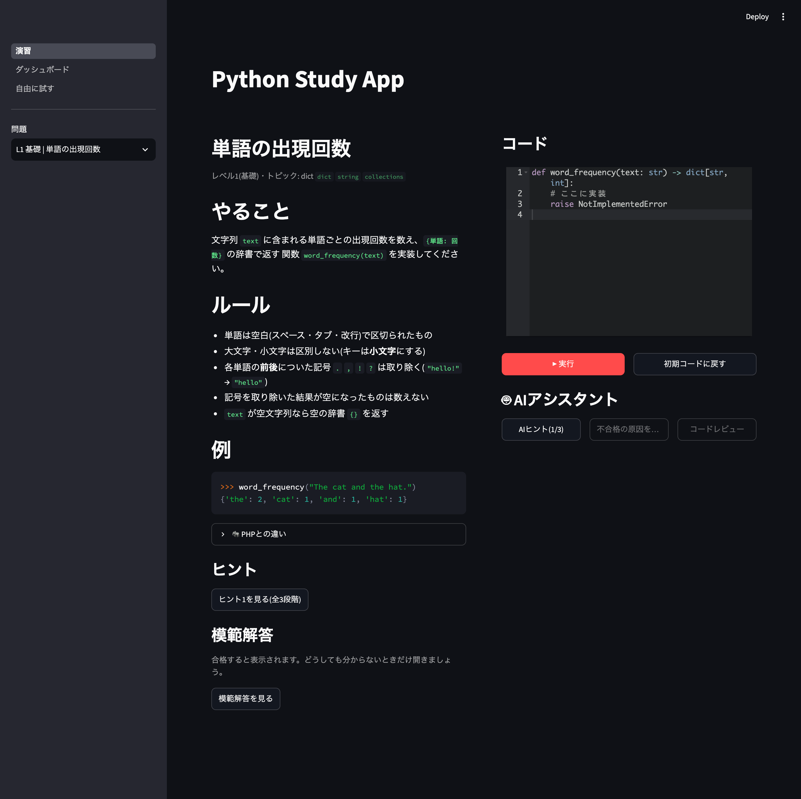
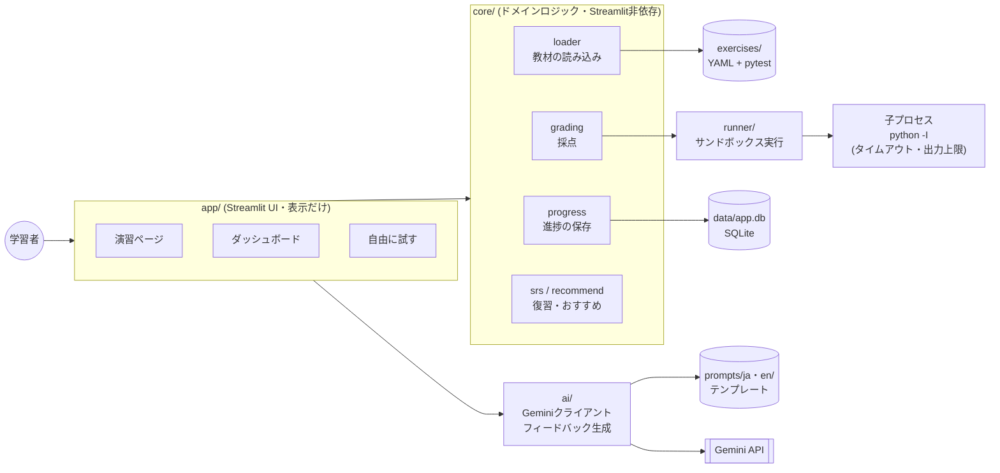

# Python-Study-App

[English](README.md) | **日本語**

**コードを書く → 実行 → 自動採点 → AIフィードバック** のループで、Python を「書ける」から
「使いこなせる」へ引き上げるための、ローカル専用の学習Webアプリです。

PHP での実務経験がある学習者を想定し、各演習に「PHPではこう書くが、Pythonではこう書く」
という対比メモを付けています。



## 主な機能

| 機能 | 内容 |
|---|---|
| ✍️ コーディング演習 | 20問(4レベル)。お題を読み、エディタで書いて「▶ 実行」すると pytest / 標準入出力で自動採点 |
| 💡 3段階ヒント | 教材のヒントを1段階ずつ開示。模範解答は合格後(または明示的に「見る」を押した後)だけ表示 |
| 🤖 AIフィードバック | Gemini API による段階的ヒント・不合格の原因解説・合格後のコードレビュー(答えのコードは出さない) |
| 📊 ダッシュボード | 合格数・連続学習日数・トピック別習熟度・苦手トピック・問題ごとの状態・学習履歴 |
| 🔁 復習(間隔反復) | 合格した問題を 1日後 → 3日後 → 7日後 に再出題。「今日やること」でおすすめを表示 |
| 🧪 自由に試す | お題なしでコードを実行し、AI にレビューしてもらえる |
| 📤 エクスポート | 学習ログを CSV(Excel対応)・JSON でダウンロード |
| 🌐 日本語 / English | サイドバーのボタンで画面・教材・AI の回答の言語を切り替え |

### 教材(20問)

| レベル | トピック |
|---|---|
| 1 基礎 | dict / 制御構文(標準入出力) / 文字列 / set / 関数(デフォルト引数のバグ修正) |
| 2 中級 | ジェネレータ / 内包表記 / デコレータ / コンテキストマネージャ / dataclass と独自例外 |
| 3 標準ライブラリ | pathlib / collections / itertools / datetime / re |
| 4 実務 | argparse(CLI) / asyncio / urllib.parse(HTTP) / テストしやすい設計 / json(設定の検証) |

## セットアップ

必要なものは [uv](https://docs.astral.sh/uv/) だけです(Python 3.12 は uv が自動で用意します)。
macOS で動作確認しています。Linux でも動く想定です。**Windows では動きません**
(コード実行の制限に、Windows に無い `resource` モジュールを使っているため。WSL2 なら動く想定です)。

```bash
# uv が無ければインストール(macOS / Linux)
curl -LsSf https://astral.sh/uv/install.sh | sh

git clone https://github.com/shim369/Python-Study-App.git
cd Python-Study-App
uv sync                               # 依存パッケージをインストール
uv run streamlit run app/main.py      # 起動 → ブラウザで http://localhost:8501 が開く
```

### AI機能を使う場合(任意)

AI機能が無くても、演習・採点・ダッシュボードはすべて使えます。

1. [Google AI Studio](https://aistudio.google.com/apikey) で Gemini の APIキーを無料で発行する
2. 設定ファイルを作り、`GEMINI_API_KEY=` の後ろにキーを書く
   ```bash
   cp .env.example .env
   ```
3. アプリを再起動する

| 環境変数 | 内容 | 省略時 |
|---|---|---|
| `GEMINI_API_KEY` | Gemini の APIキー | AI機能が無効になる |
| `GEMINI_MODEL` | 使うモデル。混雑時やエラーが続くときは `gemini-3.5-flash-lite` などに変える | `gemini-3.8-flash` |
| `STUDY_APP_DB_PATH` | 進捗を保存する SQLite ファイル(相対パスはプロジェクト直下から) | `data/app.db` |

> **注意**: Gemini API の無料枠では、送信した内容(あなたのコードや演習の文章)が
> Google の製品改善に利用されます。秘密の情報をコードに書かないでください。

## 使い方

1. **演習**: 左のサイドバーで問題を選ぶ → 右のエディタで書く → 「▶ 実行」
   - 不合格なら、ケースごとの結果とエラーを確認。ヒントや「🤖 不合格の原因を考える」を使う
   - 合格すると模範解答と「🤖 コードレビュー」が使えるようになる
   - サイドバーの印: ✅ 合格 / ✏️ 挑戦中 / 🔁 復習の時期
2. **ダッシュボード**: 「今日やること」の「解く」から、復習やおすすめの問題に移動できる
3. **自由に試す**: 標準入力を指定してコードを実行。演習以外の実験用(結果は保存されない)
4. **言語の切り替え**: サイドバーの「日本語 / English」で、画面の文言・教材(問題文・ヒント・初期コードのコメント)・
   AI の回答の言語が切り替わる。書きかけのコードは切り替えても消えない

進捗は `data/app.db` に保存され、アプリを再起動しても残ります。
最初からやり直したいときは、アプリを止めてこのファイルを削除してください。

## アーキテクチャ



- **app/** は表示と入力の受け渡しだけ。ルール(模範解答をいつ見せるか、復習の時期など)は **core/** に置き、単体テストしている
- **runner/** は学習者のコードを別プロセスで実行する。core から呼ばれるだけで、UI のことは知らない
- **ai/** は API の失敗やキー未設定でも例外を外に出さず、画面に出せるメッセージを返す
- AI へのプロンプトは **prompts/ja/**・**prompts/en/** のテキストファイルに分離している(コードにハードコードしない)
- 画面の文言は **locales/ja.yaml**・**locales/en.yaml** にまとめ、`core/i18n.py` がキーで引く

### ディレクトリ構成

```
app/            Streamlit UI(main.py とページ)
core/           採点・進捗・復習・おすすめ・エクスポート
runner/         学習者コードの隔離実行
ai/             Gemini クライアントとフィードバック生成
prompts/        AI プロンプトのテンプレート(ja/・en/)
locales/        画面の文言(ja.yaml・en.yaml)
exercises/      教材 level{1-4}/<NNN_slug>/(exercise.yaml + test_solution.py)
scripts/        verify_solutions.py(全演習の模範解答検証)
tests/          pytest
.claude/skills/ Claude Code 用 Skills(add-exercise / review-exercise / verify-app)
```

## 開発

```bash
uv run pytest                          # テスト
uv run pytest --cov=core --cov=runner  # カバレッジ
uv run ruff check . && uv run ruff format .
uv run mypy .                          # mypy --strict
uv run python scripts/verify_solutions.py           # 全演習の模範解答を検証
uv run python scripts/verify_solutions.py --list    # 演習の一覧
uv run python scripts/verify_solutions.py --id <id> --try cheat.py  # 任意のコードで採点
```

### 演習を追加する

教材はコードではなくデータです。`exercises/level<N>/<NNN>_<slug>/` に次の2ファイルを置くと、
再起動後に自動で読み込まれます。

- `exercise.yaml`: お題・初期コード・ヒント(3段階)・模範解答・PHPとの違い・英訳(`en:`)など
- `test_solution.py`: 採点用の pytest(学習者のコードは `solution.py` として import される)

`verify_solutions.py` で「模範解答が合格し、初期コードが不合格になる」ことを必ず確認してください。
[Claude Code](https://claude.com/claude-code) を使う場合は、`add-exercise` Skill が作成から検証までを、
`review-exercise` Skill が抜け穴のチェックを行います。

## 制約事項(必ずお読みください)

### ローカル専用です

このアプリは **自分のPCで、自分が書いたコードを動かす** ことだけを想定しています。
**インターネットに公開してはいけません。** 公開すると、誰でもあなたのPC上で任意のコードを
実行できてしまいます。公開する場合は、Docker / gVisor / Firecracker などのコンテナや仮想マシンによる
本格的なサンドボックスが必要です。

### 学習者コードの実行で対策していること

- 別プロセス(`python -I`)で、毎回作り直す一時ディレクトリの中で実行する
- タイムアウト(既定5秒)を超えたら、プロセスグループごと強制終了する
- CPU時間・書き込めるファイルサイズを制限する(`resource.setrlimit`)
- 標準出力・標準エラーは 64KB で打ち切る
- 環境変数を引き継がない(APIキーなどが学習者コードから見えない)

### 対策できていないこと

- **ネットワークアクセス**: 学習者のコードは外部と通信できます
- **ファイルシステム**: 一時ディレクトリの外のファイルも、あなたの権限で読み書き・削除できます
  (例: `shutil.rmtree` でホームディレクトリを消すコードも実行できてしまいます)
- **メモリ使用量**: macOS では `RLIMIT_AS` が効かないため、メモリを大量に使うコードは止められません
- **プロセスの生成**: 子プロセスを作るコードは実行できます(タイムアウト時はグループごと終了します)

信頼できないコード(ネットで拾ったものなど)は貼り付けて実行しないでください。

### その他

- AI の回答は誤っていることがあります。最終的には実行して確かめてください
- 復習の間隔は固定(1日・3日・7日)の簡易版です

## ライセンス

[MIT License](LICENSE) © 2026 Shimpei Ohtani
