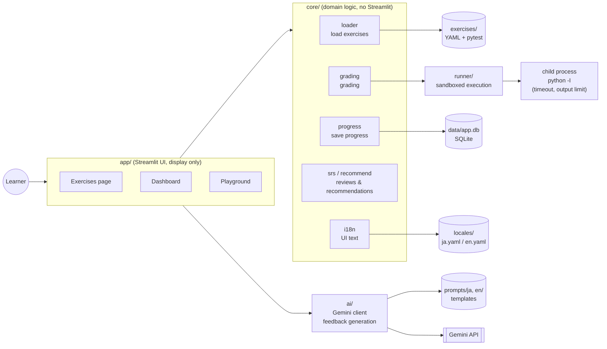

# Python-Study-App

**English** | [日本語](README.ja.md)

A local-only web app for learning Python through a loop of **write code → run → automatic grading → AI feedback**,
taking you from "can write Python" to "fluent in Python".

It is aimed at learners with professional PHP experience: every exercise comes with a note contrasting
"how you'd write it in PHP" with "how you write it in Python".


## Features

| Feature | Description |
|---|---|
| ✍️ Coding exercises | 20 exercises (4 levels). Read the task, write code in the editor and press "▶ Run" to have it graded automatically with pytest / standard I/O |
| 💡 3-level hints | Exercise hints are revealed one level at a time. The model solution is shown only after you pass (or explicitly choose to view it) |
| 🤖 AI feedback | Step-by-step hints, failure explanations and post-pass code reviews via the Gemini API (it never gives away the solution code) |
| 📊 Dashboard | Exercises passed, study streak, mastery by topic, weak topics, per-exercise status and study history |
| 🔁 Review (spaced repetition) | Exercises you've passed come back after 1 → 3 → 7 days. "To do today" shows recommendations |
| 🧪 Playground | Run code without an exercise and have the AI review it |
| 📤 Export | Download your study log as CSV (Excel-compatible) or JSON |
| 🌐 English / 日本語 | A sidebar button switches the language of the UI, the exercises and the AI's answers |

### Exercises (20)

| Level | Topics |
|---|---|
| 1 Basics | dict / control flow (standard I/O) / strings / set / functions (fixing a default-argument bug) |
| 2 Intermediate | generators / comprehensions / decorators / context managers / dataclasses and custom exceptions |
| 3 Standard library | pathlib / collections / itertools / datetime / re |
| 4 Practical | argparse (CLI) / asyncio / urllib.parse (HTTP) / designing for testability / json (config validation) |

## Setup

All you need is [uv](https://docs.astral.sh/uv/) (uv sets up Python 3.12 for you).
Tested on macOS, and expected to work on Linux. **It does not work on Windows**
(code execution limits use the `resource` module, which Windows lacks; it should work under WSL2).

```bash
# Install uv if you don't have it (macOS / Linux)
curl -LsSf https://astral.sh/uv/install.sh | sh

git clone https://github.com/shim369/Python-Study-App.git
cd Python-Study-App
uv sync                               # install dependencies
uv run streamlit run app/main.py      # start → http://localhost:8501 opens in your browser
```

The UI starts in Japanese. Switch to English with the "日本語 / English" button at the top of the sidebar.

### Using the AI features (optional)

Exercises, grading and the dashboard all work without the AI features.

1. Get a free Gemini API key from [Google AI Studio](https://aistudio.google.com/apikey)
2. Create the config file and put your key after `GEMINI_API_KEY=`
   ```bash
   cp .env.example .env
   ```
3. Restart the app

| Environment variable | Description | Default |
|---|---|---|
| `GEMINI_API_KEY` | Gemini API key | AI features are disabled |
| `GEMINI_MODEL` | Model to use. If it's busy or errors keep happening, switch to something like `gemini-3.5-flash-lite` | `gemini-3.8-flash` |
| `STUDY_APP_DB_PATH` | SQLite file for storing progress (relative paths are from the project root) | `data/app.db` |

> **Note**: On the Gemini API free tier, what you send (your code and the exercise text)
> is used by Google to improve its products. Don't put secrets in your code.

## Usage

1. **Exercises**: pick an exercise in the left sidebar → write code in the editor on the right → "▶ Run"
   - If it fails, check the result and error for each case. Use the hints or "🤖 Explain the failure"
   - Once you pass, the model solution and "🤖 Code review" become available
   - Sidebar marks: ✅ passed / ✏️ in progress / 🔁 due for review
2. **Dashboard**: use "Solve" under "To do today" to jump to reviews and recommended exercises
3. **Playground**: run code with the standard input of your choice. For experiments outside the exercises (nothing is saved)
4. **Switching language**: "日本語 / English" in the sidebar switches the UI text, the exercises (task, hints,
   comments in the starter code) and the language of the AI's answers. Code you've started writing is kept when you switch

Progress is saved in `data/app.db` and survives restarts.
To start over, stop the app and delete this file.

## Architecture



- **app/** only handles display and passing input along. Rules (when to show the model solution, when reviews are due, etc.) live in **core/** and are unit-tested
- **runner/** runs the learner's code in a separate process. It is only called from core and knows nothing about the UI
- **ai/** never lets exceptions escape on API failures or a missing key; it returns a message that can be shown on screen
- AI prompts are kept in text files under **prompts/ja/** and **prompts/en/** (never hard-coded)
- UI text is collected in **locales/ja.yaml** and **locales/en.yaml**, and `core/i18n.py` looks it up by key

### Directory layout

```
app/            Streamlit UI (main.py and pages)
core/           grading, progress, reviews, recommendations, export, i18n
runner/         isolated execution of learner code
ai/             Gemini client and feedback generation
prompts/        AI prompt templates (ja/, en/)
locales/        UI text (ja.yaml, en.yaml)
exercises/      exercises level{1-4}/<NNN_slug>/ (exercise.yaml + test_solution.py)
scripts/        verify_solutions.py (checks the model solutions of all exercises)
tests/          pytest
.claude/skills/ Skills for Claude Code (add-exercise / review-exercise / verify-app)
```

## Development

```bash
uv run pytest                          # tests
uv run pytest --cov=core --cov=runner  # coverage
uv run ruff check . && uv run ruff format .
uv run mypy .                          # mypy --strict
uv run python scripts/verify_solutions.py           # verify the model solutions of all exercises
uv run python scripts/verify_solutions.py --list    # list exercises
uv run python scripts/verify_solutions.py --id <id> --try cheat.py  # grade any code
```

### Adding an exercise

Exercises are data, not code. Put these two files in `exercises/level<N>/<NNN>_<slug>/`
and they are loaded automatically after a restart.

- `exercise.yaml`: task, starter code, hints (3 levels), model solution, PHP comparison, English translation (`en:`), etc.
- `test_solution.py`: pytest tests for grading (the learner's code is imported as `solution.py`)

Always use `verify_solutions.py` to confirm that "the model solution passes and the starter code fails".
If you use [Claude Code](https://claude.com/claude-code), the `add-exercise` Skill handles everything from
creation to verification, and the `review-exercise` Skill checks for loopholes.

## Limitations (please read)

### Local use only

This app is designed only for **running code you wrote yourself, on your own computer**.
**Do not expose it to the internet.** If you do, anyone can run arbitrary code on your computer.
Exposing it would require a proper sandbox using containers or virtual machines such as
Docker / gVisor / Firecracker.

### What is done to contain learner code

- It runs in a separate process (`python -I`) inside a temporary directory that is recreated every time
- If it exceeds the timeout (5 seconds by default), the whole process group is killed
- CPU time and the size of files it can write are limited (`resource.setrlimit`)
- Standard output and standard error are cut off at 64KB
- Environment variables are not passed on (API keys etc. are invisible to learner code)

### What is not contained

- **Network access**: learner code can talk to the outside world
- **File system**: files outside the temporary directory can be read, written and deleted with your permissions
  (e.g. code that wipes your home directory with `shutil.rmtree` will run)
- **Memory usage**: `RLIMIT_AS` has no effect on macOS, so code that uses huge amounts of memory can't be stopped
- **Process creation**: code that spawns child processes can run (the whole group is killed on timeout)

Don't paste and run code you don't trust (such as code found on the internet).

### Other notes

- The AI's answers can be wrong. Always run the code to check in the end
- The review intervals are a simple fixed version (1, 3 and 7 days)
- Some exercises check Japanese output strings (e.g. greetings), so the English version shows those strings as is

## License

[MIT License](LICENSE) © 2026 Shimpei Ohtani
